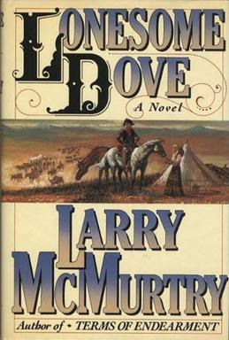
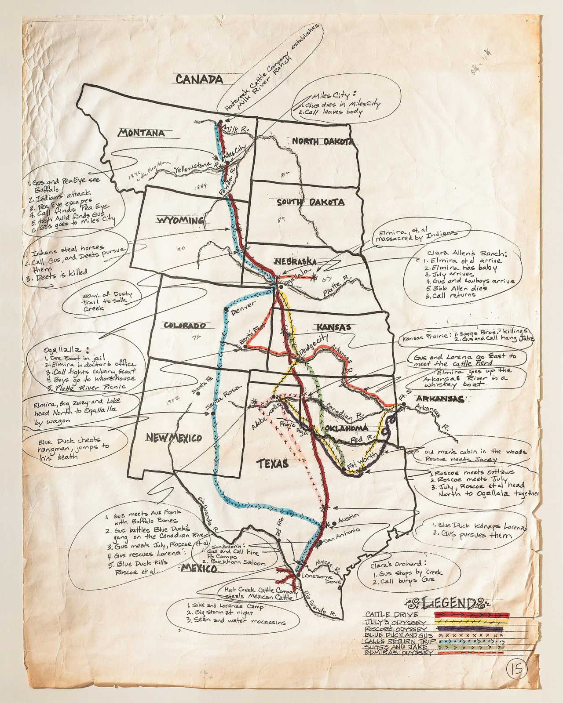

# Lonesome Dove

```
Created at: 2026-10-26
```



It's back in the 1870's, the American civil war is over and the Native American
tribes are being pushed back to reservation land. Texas and Mexico were full of
cattle and horses for the taking, and no one better for the task than the two
ex Texas Rangers, Woodrow Call and Augustus McCrae. The two men are now in
their 50's and to think about how they have aged is quite a bitter sweet memory
for me now that I come to this 3rd book.

But nothing better for a Westerner book than a story about two cowboys driving
cattle all the way from the Mexican border up to the Canadian border. The story
telling and character development is just brilliant, even after I have read
pretty much the two prequels which were plenty of character building
themselves.

There were a lot of sad deaths in the prequels (Big Foot Wallace, Long Bill
Coleman, Buffalo Hump, etc), but none as striking and sad as Gus's death. It
was hard to watch that character die as it felt like Gus was the real glue that
put everything together. But it did provide a lot for the plot, and I am glad
that I read the prequels so that I had more time to spend with Gus.

I must say that taking to reading the Lonesome Dove series in chronological
order definitely paid off. The 3rd book of the series (Lonesome Dove) is the
one that won the Pulitzer Prize, but I think that there is so much depth in the
prequels that I can't decide whether it was a superior work or not.

That said, I believe this book stands on its own, and I could easily just have
read it and be done with it. But now that I have read Dead Man's Walk and
Comanche Moon, I believe that I would be missing something out if I had not
read them.

I am unsure if I will read the final book, and I am a bit down that my
favourite characters are gone, but I will let the dust settle first and decide
about that later. It is at least a good thing to know that I have one more book
from this series to come back to in the future.

## Map of the epic drive



## Quotes from the series


> The Rangers were camped on the Rio Grande, west of the alkaline Pecos. They
> were almost three hundred miles from the nearest civilized habitation, and
> the country between them and a town was not inviting.

> Call had never been so happy in his life—overnight he had become a Texas
> Ranger, the grandest thing anyone could possibly be.

> “I was watching you youngsters take target practice yesterday. Half of you
> couldn’t hit your foot if your gun barrel was resting on it.”

> “I don’t like ’em,” Gus said, vehemently. He didn’t like it that there were
> men who could scare him so badly that he was even afraid to take a shit.

> “He’s a cutter, ain’t he?” Long Bill commented. “Meets a girl and the next
> thing you know, he’s off to hunt a preacher.”

> Buffalo Hump looked at Caleb for the first time, lifting the bowls. Then he
> took a place on the robe and handed the bowls to his young wives, who then
> began to take turns feeding him with their fingers. “If I could find a woman
> to hand-feed me sweetbreads, I expect I’d get married too,” Caleb said. “Tell
> that to the rascal.”

> Call felt that he had been rude, a little, in not being able to answer her
> questions any better than he had. He didn’t understand why women had such a
> need to question. He himself preferred just to let life happen, and act when
> opportunity arose.

> When the Texans entered Lady Carey’s room they were shocked to see Matilda
> Roberts, pink-faced, and with wet hair, in a clean white smock, sitting on a
> stool eating biscuits.

> BY MORNING Augustus McCrae was so tired that he had lost the ability to tell
> up from down.

> Young Pea Eye Parker was so hungry, he found it hard to pay attention to the
> conversation. For one thing, he couldn’t figure out what a food chain could
> be, unless the Captain was talking about link sausage. How a beetle in a
> country he had never heard of could turn a dead man into link sausage was
> beyond his ken. Deets’s stew pot was bubbling furiously; now and then, a good
> odor drifted his way. His only opinion was that he himself did not intend to
> be buried naked. It would be a hard shock to his ma if he came walking into
> heaven without a stitch.

> “The tragedy of man is not death or epidemic or lust or rage or fitful
> jealousy,” he said loudly—his voice tended to rise while declaiming
> unpleasant facts. “No sir, the tragedy of man is boredom, sir—boredom!” the
> Captain said. “A man can only do a given thing so many times with freshness
> and spirit—then, no matter what it is, it becomes like an office task. I
> enjoy cards and whoring, but even cards and whoring can grow boresome. You
> tup your wife a thousand times and that becomes an office task, too.”

> BUFFALO HUMP had taught Blue Duck that the safest time to attack a white man,
> and a Texas Ranger particularly, was while the man was squatting to do his
> morning business. The whites were foolish in their choice of clothes; they
> wore tight trousers that slowed their movements when they squatted to shit.
> Blue Duck, like most braves, only wore leggins—even those he discarded unless
> it was bitter cold. The leggins didn’t interfere with his movements, if he
> had to rise quickly. But a squatting white man was like a hobbled horse: you
> could put an arrow in him or even jump on him and cut his throat before he
> could get his pants up and run.

> He was reminded of an old bull buffalo he and Call and Bigfoot Wallace, the
> famous scout, had struggled to kill years before on the Mexican plain. They
> had shot the beast more than twenty times, chased it until one of their
> horses died, and had finally had to dispatch it with their bowie knives, a
> process that bloodied Augustus from shoulder to calf.

> Kicking Wolf would eat little, for a day or two before a raid. He wanted his
> body to empty out its smells. Then he gathered herbs and rubbed them on
> himself, on his armpits, on his privates, on his feet. He chewed sweet roots
> to make his breath inoffensive. He prepared carefully, but mainly it was his
> grace, his ability to move without sound, that enabled him to go into a herd
> of strange horses at night and not alarm them. He wanted to be able to move
> close to the horses and stroke them—he wanted the stroking to begin before
> the horse was even aware that a man was there. Once he had the horse’s trust
> he could move through the herd seeing that all the horses stayed calm. It was
> important to start with a horse that had calmness in him—often Kicking Wolf
> would study a horse herd for a few days, until he had selected the horse that
> he would approach first—it had to be a horse with calmness in it, a horse
> unlikely to panic.

> “A genius is somebody with six toes or more on one foot,” Long Bill declared.
> “That’s what I was told at home.” Neely Dickens, a small, reedy man prone to
> quick darting motions that reminded Gus of minnows, took a different view.
> “Geniuses don’t have no warts,” he claimed. “In that case I’m a genius
> because I am rarely troubled with warts,” Augustus said. “I’ve heard that
> geniuses are desperate smart,” Teddy Beatty said. “I met one once up in St.
> Louis and he could spell words backwards and even say numbers backwards too.”
> “Now, what would be the point of spelling backwards?” Augustus asked. “If you
> spell backwards you wouldn’t have much of a word. I expect you was drunk when
> you met that fellow.”

> the speeches of one that is desperate are as wind.

> In view of the help he had received, Famous Shoes thought he ought to lay
> aside the problem of the black ferret for a bit and go locate Captain McCrae.
> He had known Captain McCrae for a number of years and knew that he did not
> behave like most white men. Captain McCrae’s behavior reminded him of some
> friends he had who were Choctaw. Captain Call was very much a white man; he
> lived by rules. But Captain McCrae had little patience with rules; he lived
> by what was inside him, by the urgings of his heart and his spirit—and now,
> grieved by the death of his wife, Captain McCrae’s spirit urged him to get on
> his black mare and go west.

> Pea Eye wasn’t spitting out any mash whiskey. He had a skinny neck—his Adam’s
> apple bulged so when he drank that it reminded Augustus of a snake with a
> frog stuck in its gullet.

> There was only one horse hitched outside the Dry Bean when Augustus strolled
> up—a rangy sorrel that he recognized as belonging to a cowboy named Dishwater
> Boggett,

> “Pea, when was you born?” Dish asked, grinning at Newt. The question threw
> Pea into confusion. He had been thinking about the girl he had seen in the
> window; to be asked when he was born meant stopping one line of thought and
> trying to shift to another, more difficult line. “Why you’d best ask the
> Captain that, Dish,” he said mildly. “I can’t never remember.”

> “Better to have it and not need it than to need it and not have it,” he
> added, a little solemnly.

> “Son, we’re fresh out,” Augustus said. “Can either of you boys shoot?” “No,
> but we can dig potatoes,” Allen said—he didn’t want the man to think they
> were totally incompetent.

> “Dern, this is the best birds’-egg pie I ever tasted,” Jasper admitted. “It’s
> better than hen’s eggs.” “Don’t you even know an omelet when you see one,
> Jasper?” Augustus said. He was miffed to see the new cook become a hero in
> five minutes, whereas he had cooked excellent biscuits for years and drawn
> little praise.

> In some way Lorie would always be as distant from him as the Kansas stars. At
> times he felt that he had almost rather not be in love with her, for it
> brought him no peace. What was the use of it, if it was only going to be so
> painful? And yet, she had spoken to him in a friendly voice only that day. He
> couldn’t give up while there was a chance.

> At night, alone, he grew bitter at himself for indulging in such pointless
> thoughts. It was like the business with Maggie that Gus harped on so. His
> mind tried to change it, have it different, but those too were pointless
> thoughts. Things thought and things said didn’t make much difference and with
> Gus spending all his time with the woman there was very little said anyway.

> “You’re so sure you’re right it doesn’t matter to you whether people talk to
> you at all. I’m glad I’ve been wrong enough to keep in practice.” “Why would
> you want to keep in practice being wrong?” Call asked. “I’d think it would be
> something you’d try to avoid.” “You can’t avoid it, you’ve got to learn to
> handle it,” Augustus said. “If you only come face-to-face with your own
> mistakes once or twice in your life it’s bound to be extra painful. I face
> mine every day—that way they ain’t usually much worse than a dry shave.”

> “If it was to cover you up, I reckon you’d freeze,” he said, over and over,
> until the men were tired of hearing it. Most of the men were tired of hearing
> one another say anything—the complaints characteristic of each had come to
> bore them thoroughly as a group.

> “Your horse but not your name?” Clara said. “You haven’t even given him your
> name?” “I put more value on the horse,” Call said, turning the dun. He rode
> off, but Clara, terrible in her anger, strode beside him. “I’ll write him,”
> she said. “I’ll see he gets your name if I have to carry the letter to
> Montana myself. And I’ll tell you another thing: I’m sorry you and Gus McCrae
> ever met. All you two done was ruin one another, not to mention those close
> to you. Another reason I didn’t marry him was because I didn’t want to fight
> you for him every day of my life. You men and your promises: they’re just
> excuses to do what you plan to do anyway, which is leave. You think you’ve
> always done right—that’s your ugly pride, Mr. Call. But you never did right
> > and it would be a sad woman that needed anything from you. You’re a vain
