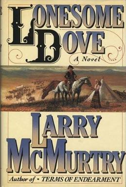
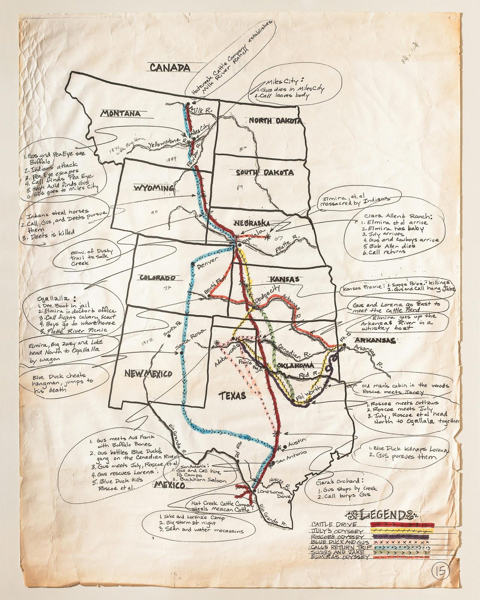

# Lonesome Dove

```
Created at: 2026-10-26
```



It's back in the 1870's, the American civil war is over and the Native American
tribes are being pushed back to reservation land. Texas and Mexico were full of
cattle and horses for the taking, and no one better for the task than the two
ex Texas Rangers, Woodrow Call and Augustus McCrae. The two men are now in
their 50's and to think about how they have aged is quite a bitter sweet memory
for me now that I come to this 3rd book.

But nothing better for a Westerner book than a story about two cowboys driving
cattle all the way from the Mexican border up to the Canadian border. The story
telling and character development is just brilliant, even after I have read
pretty much the two prequels which were plenty of character building
themselves.

There were a lot of sad deaths in the prequels (Big Foot Wallace, Long Bill
Coleman, Buffalo Hump, etc), but none as striking and sad as Gus's death. It
was hard to watch that character die as it felt like Gus was the real glue that
put everything together. But it did provide a lot for the plot, and I am glad
that I read the prequels so that I had more time to spend with Gus.

I must say that taking to reading the Lonesome Dove series in chronological
order definitely paid off. The 3rd book of the series (Lonesome Dove) is the
one that won the Pulitzer Prize, but I think that there is so much depth in the
prequels that I can't decide whether it was a superior work or not.

That said, I believe this book stands on its own, and I could easily just have
read it and be done with it. But now that I have read Dead Man's Walk and
Comanche Moon, I believe that I would be missing something out if I had not
read them.

I am unsure if I will read the final book, and I am a bit down that my
favourite characters are gone, but I will let the dust settle first and decide
about that later. It is at least a good thing to know that I have one more book
from this series to come back to in the future.

## Map of the epic drive


