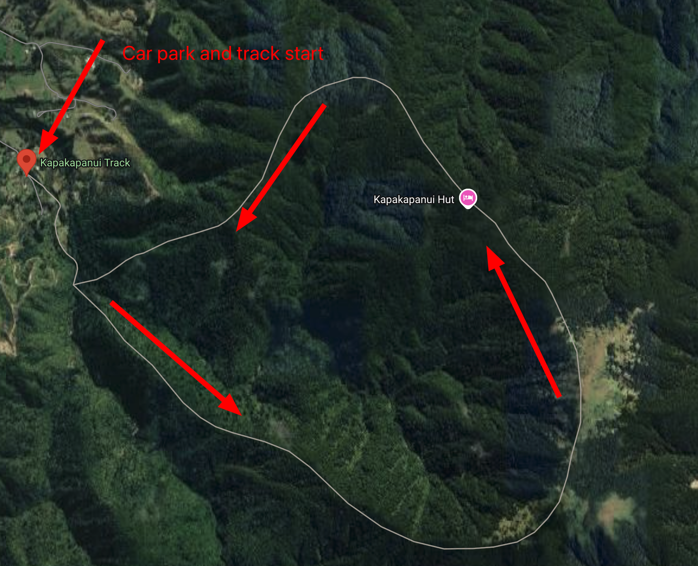
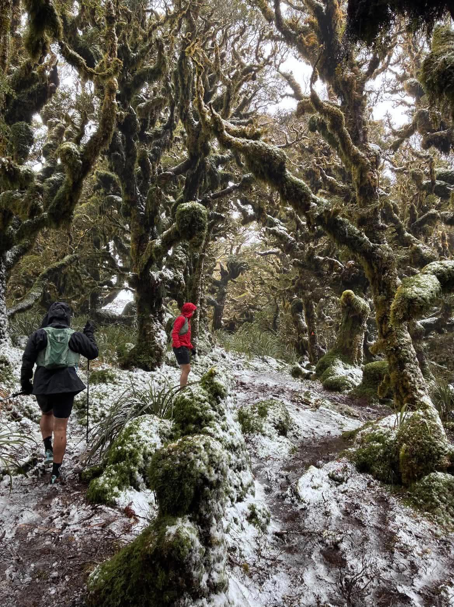

# Kapakapanui Track

```
Created at: 2026-10-21
```



This is a 15km loop track with ~1100m of elevation that starts at 395 Ngatiawa
Road, Reikorangi. I have done it anti-clockwise, because the steepest part is
at the beginning and you get to see the view of the beach on your way down.

The track is a bit challenging as it rained the day before and was very muddy.
It took me about 5-6 hours to complete.

I went at the end of October on a 14 degrees day, but there was still snow at
the peak. Make sure to bring your warm clothes and gloves (which I forgot and
made my fingers super cold).

The "goblin forest" was a highlight of the track.


