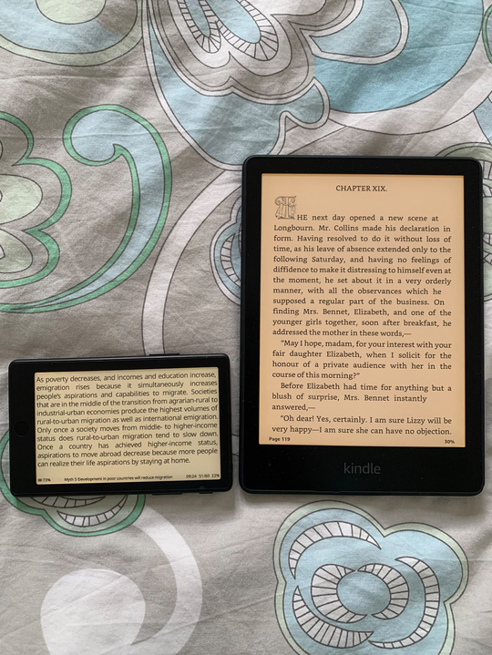

XTEINK X4 Pro review

```
Created at: 2026-11-07
```



The photo above is the NZD $200 X4 Pro next to my Kindle Paperwhite.

I always wanted to check if these ultra-small e-readers were a gimmick or not.
My biggest concern being the "reading comfort" metric, specifically the screen
length, and how many words could even fit on the screen before frequent line
breaks would start to drive me nuts.

Well, that hasn't been a problem at all. I mostly use the device on horizontal
mode, which manages to fit about 58 characters on my current font size. This
amount of characters is within the largely accepted 45-75 characters per line
metric for readability, and relatively close to the "optimum" of 66 characters
per line for printed text.

Other concerns were around battery, backlight, firmware, etc. All of those are
broken down into a list of pros and cons bellow:

## Pros

1. The back lights can be adjusted for both brightness and warmth. 
2. Physical buttons allow me to deactivate "touch mode" and turn pages by
   pressing the side buttons.
3. Small footprint means that it can fit in any pocket. It is about 2/3 the
   area of a regular phone, but thinner. It comes with a magnetic back, so you
   can snap it to the back of your phone. This makes it fairly easy to bring
   the device with you if you are going on a hike or you are in-between
   appointments or just doing a short travel somewhere.
4. Possible to jailbreak for better firmware.

## Cons

1. In comparison to my Kindle, the battery life time is not as good. I still
   use my Kindle more, because of my habit of reading before bed on my Kindle,
   but the Kindle battery holds at least 2x or 3x longer for the same level of
   use as compared to the xteink x4 pro.
2. Default firmware is not fit for purpose. Most people that buy this device
   seem to agree with that. They jailbreak the device and load it with Cross
   Point Reader immediately. I had to do this for a better experience.
3. The charger cable is finicky. They decided to go with a magnetic style cable
   that "snaps" into a little socket at the back of the device. I would much
   rather just have a USB-C slot I could plug a cable into.
4. Either the Calibre integration is also finicky or I haven't worked that out
   properly yet. I am doing book synchronisation via "Calibre server" which
   doesn't feel as good as plugin a cable onto the laptop and pressing a
   button.

## Some specifics about Cross Point Reader

1. Cross Point is being actively maintained - but some features may lag. For
   example, in the middle of writing this post I realised that the "clippings
   and highlights" feature wasn't available on the X4. Then I went to their
   GitHub and saw that a release from last week added the feature! That is
   awesome, but at the same time it is interesting that this feature wasn't in
   the base, default, installation from the gate go - it's a killer feature.
2. The documentation and functionality is not always super intuitive. For
   example, if you haven't uploaded a dictionary to the device, all the
   "dictionary" options are hidden. So you don't even know if it is possible to
   look-up a word, and where to go. That led me on a hunt across all menus to
   see if the feature was simply disabled, but in the end, the information
   explaining that the Dictionary feature was hidden in the absence of a
   dictionary file was lightly noted on a paragraph in the middle of the user
   guide. As it is natural to not have any dictionaries when setting up the
   device, it would be much better if the menu item was not hidden but simply
   said "no dictionaries".
